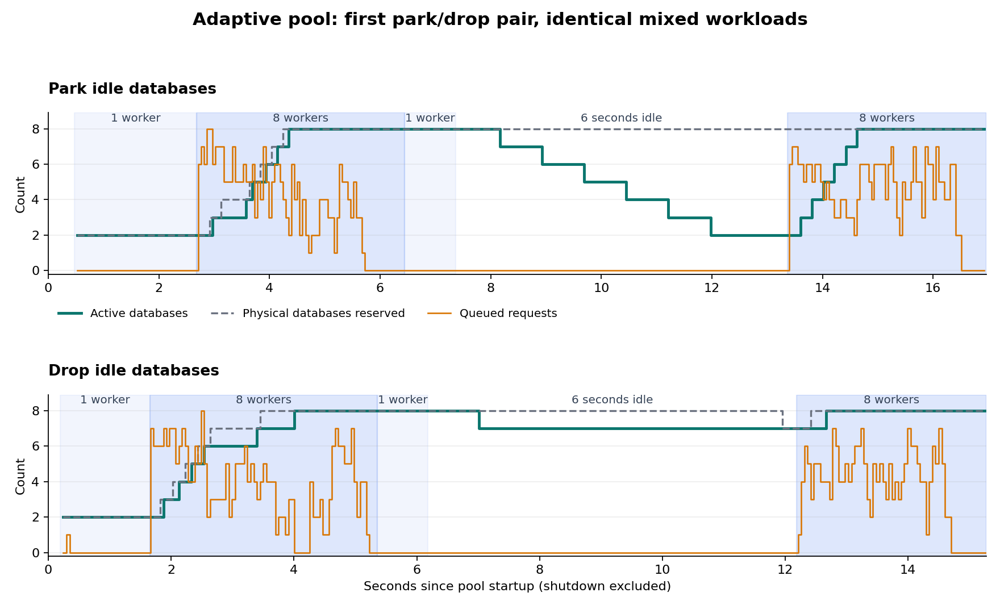

# TT-000: Pool feasibility investigation

## Decision log

- **2026-10-14:** Archive the completed 13 October experiments as the evidence for TT-001 through TT-010. The prototype question is answered; production implementation remains Open in those tickets. This archive does not claim the current library has working adaptive pooling.

## Observed production defects

At revision `d510320f6a11e98b509f6f5f9cc8cc02a1c23cfe`:

- Direct/factory context creation discards the disposal-owning wrapper through implicit conversion; disposing the returned raw context does not return/reset its database. Three sequential direct contexts with pool size one produced three live containers.
- First factory reset with ordinary driver pooling fails with PostgreSQL `55006` because source database sessions remain; the failed resource is destroyed without usable-capacity replenishment.
- First template construction occurs after schema removal, preserving an empty database rather than the intended initialized baseline.
- DI context registration calls a connection-string method that always throws. The service factory initializes a private pool then delegates to the static global owner, creating duplicate pools and ignoring owner configuration.
- Static disposal retains initialized state pointing to the disposed pool; source inspection identifies the recreate-after-dispose regression to cover.

These findings are assigned to the Open tickets. The prototype bypasses these paths after initial container creation, so its passing checks do not resolve them.

## Retained evidence

The [archive manifest](../../evidence/2026-10-13/manifest.json) records original paths, original and archived hashes, and file sizes. Raw sample JSON is losslessly gzip-compressed. Historical C#/project/Python sources are stored as `.txt`, so they do not become maintained code or compile through recursive project globs. No build caches are copied. The rejected zero-row run is excluded; its notice, faulty workload source and failing workload diagnostic are retained.

- [Premise probe results](../../evidence/2026-10-13/premise/results.json.gz), [direct disposal](../../evidence/2026-10-13/premise/direct.log.txt), [pooled factory reset](../../evidence/2026-10-13/premise/factory.log.txt), [DI resolution](../../evidence/2026-10-13/premise/di.log.txt), [no-pooling comparison](../../evidence/2026-10-13/premise/no-pooling.log.txt).
- [Reset performance results](../../evidence/2026-10-13/reset/results.json.gz), [performance run manifest](../../evidence/2026-10-13/reset/run.json), [fault RED](../../evidence/2026-10-13/reset/fault-red.log.txt), [fault GREEN](../../evidence/2026-10-13/reset/fault-green.log.txt), [fault results](../../evidence/2026-10-13/reset/fault-results.json.gz).
- Fixed/adaptive and park/drop sources, raw results, manifests and capacity plot are linked in the archived report below.

Commands and temporary paths in the historical reports describe the original execution environment. To reproduce from the archive, restore source filenames/project references into an isolated scratch project and account for gzip results; the maintained portable benchmark is future work in TT-010. Read archive sources as experimental evidence, not a production design to copy unchanged.

## Adaptive database pool experiment

Date: 13 October 2026. Repository: `/home/dan/code/TurboTest`, revision `d510320f6a11e98b509f6f5f9cc8cc02a1c23cfe`.

### Result

The prototype responds to demand and stays within its resource limits. Starting with two databases, it grows to eight during sustained queue pressure. Parking lets it return to two active databases after the burst while retaining six verified databases for reuse. All 3,660 valid workloads passed the baseline, sequence and slot-ownership checks. The harness checks each slot's database identity and its own workload markers/counts; it does not explicitly query every other database for absent markers.

Adaptation improves burst latency over an undersized fixed pool. It does not provide a universal 50 ms checkout or reset guarantee. A fully prepared pool handles the first burst faster in this run. Parking closes idle connection pools quickly but retains database files and defers their deletion cost until fixture shutdown.

This is a disposable prototype, not a production feature. It creates the initial PostgreSQL container using TurboTest, then manages its own template, exclusive database slots and Npgsql data sources. The existing public lease/reset and DI problems have not been repaired by this experiment. The repository is clean at the recorded revision.

### Fixed versus adaptive

One PostgreSQL container and one immutable seeded template were shared across configurations, run sequentially in the order below. Each configuration ran 30 operations with one worker, 240 with eight workers, then 30 with one worker. All operations changed seed data as well as inserting rows.

| Policy, in execution order | Prepared pool startup, ms | Peak checkout p95, ms | Peak return-to-ready p95, ms | Peak throughput, operations/s |
| --- | ---: | ---: | ---: | ---: |
| Fixed 4 | 677.44 | 266.35 | 48.69 | 59.78 |
| Adaptive 2–8 | 165.16 | 223.96 | 75.36 | 63.97 |
| Fixed 8 | 749.60 | 81.38 | 79.10 | 66.50 |
| Fixed 2 | 202.59 | 629.86 | 47.21 | 31.64 |
| Adaptive repeat | 172.47 | 142.28 | 81.33 | 78.05 |

Common container and template startup was a separate 9,628.91 ms. Configuration startup includes actual template clone, validation and warm connection creation for every initial slot. Adaptive configurations actually created six additional databases during load; these were not precreated and merely activated.

The original fixed/adaptive comparison has order and warm-cache confounding. The repeated adaptive result shows substantial variability. These observations do not prove a portable speedup ratio or an optimal pool size.

An idle database DROP took 4,466.90 ms and 4,952.45 ms in the two adaptive runs. This motivated the second experiment.

### Parking versus dropping

The second experiment used counterbalanced order: park, drop, drop, park. Each policy started with two databases and ran the same 1-worker → 8-worker → 1-worker workload, waited six seconds, then ran a second 8-worker burst. There were 540 operations per configuration, 2,160 total. Each policy performed actual database creation, connection disposal, and final database deletion.

| Policy, in execution order | Active / parked / reserved after idle | First burst checkout p95, ms | Second burst checkout p95, ms | Total time, s | Final pool shutdown, s |
| --- | --- | ---: | ---: | ---: | ---: |
| Park first | 2 / 6 / 8 | 198.29 | 138.24 | 22.01 | 5.04 |
| Drop first | 7 / 0 / 7 | 159.71 | 87.83 | 17.55 | 1.47 |
| Drop repeat | 6 / 0 / 7* | 201.60 | 136.36 | 18.03 | 1.22 |
| Park repeat | 2 / 6 / 8 | 174.62 | 104.69 | 20.03 | 4.91 |

\* One database was still being dropped and remained reserved. Both parking runs shrank to the two-active floor, then rewarmed all six parked databases. Each created only eight databases in total. The dropping runs created nine and ten in total, replacing databases they had removed.

Individual operations, including validation where applicable:

| Lifecycle operation | Samples | Median, ms | Range, ms |
| --- | ---: | ---: | ---: |
| Park verified database and dispose its data source | 12 | 8.53 | 7.41–10.32 |
| Recreate data source, validate seed/schema/identity and warm it | 12 | 36.37 | 33.08–38.79 |
| Drop idle database | 3 | 4,447.58 | 316.06–4,950.62 |

Parking reached the requested active-capacity floor much sooner. It did not win overall runtime for this short two-burst workload: the retained databases still had to be deleted at shutdown, and rewarming two active slots to eight still introduces burst queueing. The drop policy retained more active capacity during its slow retirement and therefore had a different starting capacity for the second burst. Individual rewarm latency is not whole-burst checkout latency.

The total-time column includes pool startup, all workload and cleanup receipts, the six-second idle period, pool shutdown and monitoring shutdown. Common container/template startup, 5,626.24 ms, is excluded from that column. Database reservation time was 152.93/141.36 slot-seconds for parking and 117.82/116.78 for dropping; parked databases remain physical reservations.



The chart shows the first park/drop pair through the second burst; final shutdown is excluded from the plot. All four runs and their scale events are retained in the raw results.

### Controller and lifecycle

These thresholds were chosen for the experiment and are not tuned production defaults:

- Minimum two active databases; maximum eight physical reservations, including preparing, retiring, quarantined and parked slots.
- Grow after at least 100 ms of continuous queue pressure with no Ready slot; at least 200 ms between growth decisions.
- Shrink after 750 ms of spare capacity with no queue and at most one leased/resetting slot; at least 300 ms between shrink decisions. Only a verified Ready slot can be selected.
- One create/rewarm/park/drop operation in flight; two actual resets executing. Waiting resets can occupy additional slots.
- `MaxPoolSize=2` per database data source. PostgreSQL client-session observations peaked at ten, including bootstrap/administration. A separate aggregate sampling guard requires at most 24. Sampling is not a proof of every transient connection count.
- Docker's container memory limit is 256 MiB. Growth/rewarm is inhibited at sampled memory usage ≥85%. The memory gate was exercised in pure controller checks; actual runs did not reach it. Observed peaks were 64.83–76.06%, with no sampling errors. CPU was observed but did not feed a growth limit.
- A lease owns one database exclusively. Return changes the slot to Resetting, waits for a reset permit, restores data/sequences and validates before adding it to the Ready queue. A failure quarantines it.
- A parked slot keeps its reservation and has a disposed data source. Rewarm recreates the source, checks seed contents, schema and database identity, then publishes Ready. A failed rewarm cannot enter the Ready queue.
- All workload reset receipts are awaited. Shutdown stops the controller, drains lifecycle work, destroys both Ready and Parked databases, and releases reservations only after successful deletion.

An independent read-only agent reviewed reservation accounting, transition order, queue publication, timing and cleanup tracking. It found no concrete lifecycle flaw in the inspected prototype. This was not a production completion review.

### Workload and measurement boundaries

The fixture is the repository's three-table `TestDbContext`: Users, Blogs and Posts. The immutable baseline has IDs 100, 200 and 300, one row in each table, and next generated IDs 101, 201 and 301. Every job changes the baseline user, deletes the baseline blog/post, and inserts 130, 1,300 or 13,000 rows across the three tables. The deterministic mix is 60% small, 30% medium, 10% large, plus five milliseconds of simulated work.

Reset uses child-first DELETE followed by baseline seed and sequence restoration. Counts, seed fields, relationships and sequence states are checked after preparation, before each workload, and after reset. Workload counts and user ownership markers are also checked. The schema fingerprint covers public columns/defaults/nullability, constraints, indexes and non-internal triggers; it is not a general catalog-integrity or migration proof.

- **Checkout** starts before requesting a slot and ends after baseline validation. It includes queue wait and acquisition verification.
- **Return-to-ready** includes waiting for a reset permit, schema check, reset and validation.
- **Cycle** runs from the slot request until the reset/readiness receipt completes. It includes checkout, workload insertion/checks, simulated work and return.
- **Phase throughput** includes all deferred cleanup receipts. It does not count work as complete when its reset is still pending.
- Quantiles use the recorded samples; p95 is the nearest-rank 95th percentile. There are no confidence intervals or repeated-machine trials.

There were 1,500 valid operations in the fixed/adaptive run and 2,160 in the park/drop run, with expected row-count mixes independently verified from results. The 44,226 and 63,791 counted data assertions are repeated checks, not that many distinct tested behaviors.

Limits: one local Linux host, shared PostgreSQL 16 server, a small fixture, a synthetic 5 ms body, no long transactions/open readers, no production failure/retry/cancellation matrix, and no production API integration. `DOTNET_PROCESSOR_COUNT=4` limits the .NET runtime's processor view; it is not a PostgreSQL CPU cap. Pooling and readiness checks introduce real overhead. Short spikes, other schema sizes, busy hosts and longer idle gaps can change the result.

### Evidence integrity and reproduction

The first workload expression accidentally yielded zero inserted rows. That run is explicitly rejected in [retained rejected-workload notice](../../evidence/2026-10-13/adaptive/REJECTED.md.txt) and is excluded from every number above. A 240-input deterministic workload check rejected the faulty expression before the corrected database run. The recorded corrected sources and all result row-count mixes were verified again by `analyze.py`.

Controller RED evidence rejects a policy that never grows. The corrected policy passed 13 behavior checks. Parking RED evidence removes the ability to reuse a parked database at the physical cap; it fails with the expected diagnostic. The corrected parking policy passed 15 checks, including the memory gate. The workload RED log names the incorrect expected/actual scale. These checks are prototype evidence, not repository CI gates.

Source hashes and commands are in each `run.json`. SDK: .NET 10.0.301. The locally cached image is `postgres:16-alpine`, ID `sha256:81bd698b4594e751a3269e4dcd3e03a4a0ec0daf7b72e7aa1abd43cce9887542`, digest `postgres@sha256:721873c34ceb9f8d8fc265984940dc982404c105f19ad51be9fdc5970a6080ea`. Both valid measured runs exited zero. Their task containers were removed; the unrelated `prismml-llamacpp-server-1` container was preserved.

Artifacts:

- Fixed/adaptive: [source](../../evidence/2026-10-13/adaptive/Program.cs.txt), [policy](../../evidence/2026-10-13/adaptive/AdaptivePolicy.cs.txt), [raw results](../../evidence/2026-10-13/adaptive/results.json.gz), [run manifest](../../evidence/2026-10-13/adaptive/run.json), [run log](../../evidence/2026-10-13/adaptive/run.log.txt).
- Park/drop: [source](../../evidence/2026-10-13/parking/Program.cs.txt), [policy](../../evidence/2026-10-13/parking/AdaptivePolicy.cs.txt), [raw results](../../evidence/2026-10-13/parking/results.json.gz), [run manifest](../../evidence/2026-10-13/parking/run.json), [run log](../../evidence/2026-10-13/parking/run.log.txt).
- [Analysis and source-integrity checker](../../evidence/2026-10-13/adaptive/analyze.py.txt), [summary](../../evidence/2026-10-13/adaptive/analysis.json), [SVG plot](../../evidence/2026-10-13/adaptive/capacity-timeline.svg).

The park/drop project was moved from a temporary child directory to the sibling path above after measurement, preserving the measured source bytes and results. This keeps .NET's default recursive compile glob from including the second project's source in the first project.

To run only the fast checks, execute `DOTNET_PROCESSOR_COUNT=4 dotnet run -c Release -- --policy-only` from either project directory. Full runs use Docker and overwrite their result files: preserve the current evidence first. The park/drop driver checks disk headroom, source identity and final container cleanup.

### Recommended production direction

Use explicit fixture-owned leases and a bounded pool of prepared databases. Adapt how many are actively warm, keep parked databases within the hard physical cap, and avoid deleting databases on every brief lull. Use an extended idle timeout or fixture shutdown for physical deletion. A warm floor or workload concurrency hint is still needed for latency-sensitive first bursts; aggressive shrinking to two predictably creates a ramp on the next burst.

Before shipping, repair the existing lease-release and reset paths, implement the baseline and quarantine contracts through the public API, and test cancellation, failed creation/rewarm/reset, schema-changing workloads, fixture disposal and concurrent demand. Select defaults from representative workloads. This experiment supports adaptive capacity with hysteresis; it does not establish an optimal controller or a universal 50 ms target.

## TurboTest reset and pool feasibility experiment

### Scope and outcome

Validated a disposable prototype, not the production TurboTest allocator. One PostgreSQL 16 container hosted four prepared databases; .NET SDK 10.0.301, DOTNET_PROCESSOR_COUNT=4. The 50 ms target is warm cleanup + seed restoration + fresh-context snapshot and sequence validation. Acquisition includes queue wait; full-cycle timing also includes test writes, simulated work, and all deferred cleanup.

The baseline contains one non-default User, Blog and Post with a real foreign-key relationship. Each workload updates the baseline user and deletes the baseline blog/post, then inserts 130, 1,300 or 13,000 test rows. Thus dirty-state totals are 131, 1,301 or 13,001; cleanup restores exactly three baseline rows. Thirty recorded samples per sequential cell are exploratory. Five parallel cells have 100 operations each. Strategies were interleaved in seeded random order.

### Recomputed measurements

Medians use the conventional middle-pair average. P95 uses nearest rank ceil(0.95*n). Raw full-run results retained their original lower-middle P50 field; P95 and maximum were independently checked and are unchanged. Zero checkout fields in sequential samples mean checkout was not measured separately.

| Scenario | n | Checkout P95 ms | Reset-to-verified-ready median / P95 / max ms | Ready samples >50 ms | Full-cycle P95 ms |
|---|---:|---:|---:|---:|---:|
| parallel-4-workers-2-slots-130-rows-background | 100 | 50.96 | 13.22 / 18.09 / 48.21 | 0 | 78.45 |
| parallel-4-workers-2-slots-130-rows-foreground | 100 | 33.73 | 13.63 / 16.32 / 18.03 | 0 | 61.22 |
| parallel-4-workers-2-slots-1300-rows-background | 100 | 92.50 | 19.13 / 24.51 / 56.45 | 1 | 137.22 |
| parallel-4-workers-4-slots-130-rows-background | 100 | 20.53 | 14.91 / 18.33 / 21.51 | 0 | 50.21 |
| parallel-4-workers-4-slots-1300-rows-background | 100 | 27.72 | 17.92 / 25.47 / 77.42 | 2 | 115.37 |
| sequential-delete-130-rows | 30 | not separate | 13.24 / 17.67 / 18.34 | 0 | 34.62 |
| sequential-delete-1300-rows | 30 | not separate | 14.46 / 18.57 / 19.54 | 0 | 35.05 |
| sequential-delete-13000-rows | 30 | not separate | 37.50 / 64.19 / 78.00 | 3 | 218.70 |
| sequential-truncate-130-rows | 30 | not separate | 59.29 / 86.54 / 88.64 | 30 | 92.95 |
| sequential-truncate-1300-rows | 30 | not separate | 58.04 / 63.12 / 64.06 | 29 | 83.89 |
| sequential-truncate-13000-rows | 30 | not separate | 60.04 / 70.80 / 74.05 | 29 | 199.70 |

### Correctness and failure probes

- Exact seed snapshots, counts, foreign-key relationships and all three sequence states were checked. Generated IDs 101/201/301 were independently asserted after sequential resets.
- A deliberately corrupted seed caused the named snapshot diagnostic; restoring the correct seed recovered the case.
- Four simultaneous leases had distinct databases and unique markers. A fifth request waited until a database was cleaned and validated; occupied slots were never lent again.
- All 500 parallel operations completed; every scenario drained its cleanup backlog and restored the expected ready capacity. Throughput includes final drain.
- Added column + extra table/data triggered template recreation and restored the known baseline schema. The entire fallback probe took about 2.84 seconds, including clone, verification, generated-ID validation and another reset; it is not a pure clone timing.
- A division-by-zero injected after deletes and a nontransactional sequence change surfaced SQLSTATE 22012. The dirty slot was quarantined, never reacquired and recovered by template clone.
- An additional fault probe reproduced a recovery-state bug: a bad replacement was marked ready before verification. The named RED assertion failed (exit 134). The prototype now verifies while quarantined, then publishes. GREEN also checks corrupt seed after commit, replacement rejection and restored capacity (exit 0, 324 assertions).

### Decisions supported by the evidence

- Keep driver connection pooling and prepared schema; warm pool checkout was already around 1 ms in the prior experiment. Holding an extra connection open had little benefit.
- Use a cached foreign-key-aware row cleanup plan and explicit baseline restoration for ordinary data-only tests. DELETE meets the observed warm-ready 50 ms target at 130/1,300 rows sequentially; the 13,000-row P95 exceeds it.
- Size ready database capacity to test concurrency. Four workers/two slots incur substantial wait; four slots reduce checkout P95. Background cleanup at two small-data slots showed essentially the same throughput as foreground cleanup (71.56 vs 71.21 operations/s). It does not create capacity.
- Publish a database only after cleanup and validation. Failed reset or recovery stays quarantined; fixed capacity/backpressure replaces unbounded overflow containers.
- Give schema-changing tests a template recreation lane. The current fingerprint only covers public columns/defaults/nullability, constraints, indexes and non-internal triggers; it is not a universal schema drift detector.
- Treat 50 ms as a workload-specific warm target, not a guarantee for every schema, data volume or parallel test cycle. Larger parallel cases showed tails above 50 ms even when P95 was below it.

### Reproduction and retained evidence

```bash
cd /tmp/turbotest-reset-ideas-20261013
DOTNET_PROCESSOR_COUNT=4 dotnet run --project Ideas.csproj --configuration Release
DOTNET_PROCESSOR_COUNT=4 dotnet run --project Ideas.csproj --configuration Release -- --fault-only
```

Performance source: Program-full-run.cs.txt; run.json records its SHA256. Raw data: results.json. Initial recovery fault: Program-fault-red.cs.txt, fault-red.log/json. Corrected recovery: current Program.cs, fault-green.log/json and fault-results.json. The performance path was not changed by the recovery ordering fix; full performance measurements were retained rather than rerun unnecessarily.

PostgreSQL image ID: sha256:81bd698b4594e751a3269e4dcd3e03a4a0ec0daf7b72e7aa1abd43cce9887542. Digest: postgres@sha256:721873c34ceb9f8d8fc265984940dc982404c105f19ad51be9fdc5970a6080ea.

Limitations: one local host, one EF model, finite datasets and fixed seed; no general dependency-cycle, RLS, routine/view/type/grant/extension/non-public-schema restoration proof. Clone failure, enqueue cancellation and competing recovery attempts were not injected. Repeated assertion counts are not distinct behavior counts. Production code and its known lifecycle bugs remain unchanged. All task containers were removed; repository remains clean.
